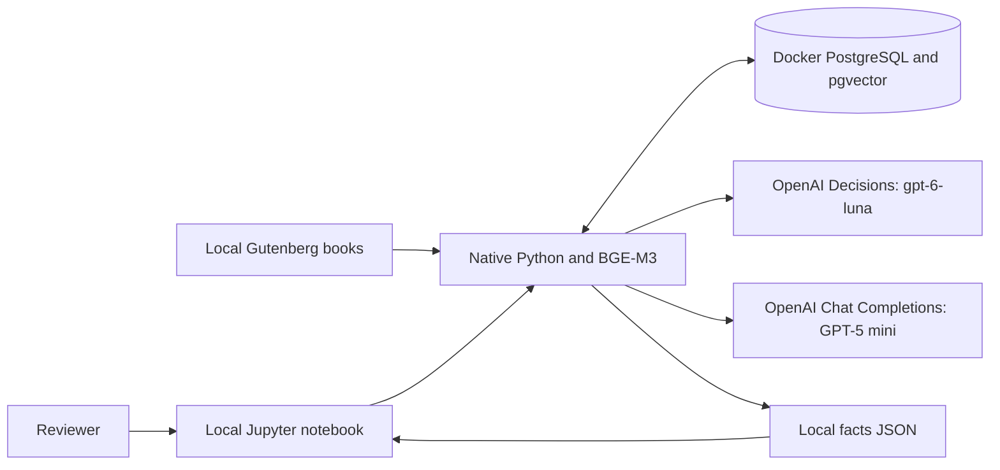

# Architecture

## Context and containers

Python and embeddings run on the local machine. PostgreSQL is the only container.
Model inference calls OpenAI directly using `OPENAI_API_KEY` from `.env`.
Classification uses `/v1/decisions`; extraction uses `/v1/chat/completions`.

## Data flow

1. `ingest.py` reads books from `data/books/`, takes titles from filenames, strips Gutenberg wrappers,
   splits overlapping chunks and creates pinned 1,024-dimensional BGE-M3 embeddings.
   Two database tables hold books and chunks. Before a new experiment, the visible
   notebook loop checks selected filenames through `book_needs_ingestion` and calls
   `ingest(settings, [book])` only for missing or changed books. Database checks and
   embedding details stay in Python functions. Saved experiments skip book checks.
2. `search.py` embeds the single research question once, then selects up to `TOP_K`
   chunks per selected book using dense similarity (50 by default).
3. `classify.py` sends each candidate to OpenAI Decisions (`gpt-6-luna`) using notebook
   instructions and choices. Location is not required for this filter; extraction checks
   location evidence later. It validates the named answer from the API's answers array. Only confident drops (>= 0.8 by default) are excluded; keep/uncertain
   and low-confidence drops proceed. This cutoff has not been evaluated. Failures stop
   the run without saving partial facts. No classification sidecars are written.
4. `extract.py` sends sequential batches of up to `EXTRACTOR_BATCH_SIZE` chunks (default 10)
   with a strict JSON schema. Each fact returns a chunk ID that must belong to the batch.
   Python validates evidence against that specific chunk and supplies book metadata.
   Output allowance scales with batch size to a maximum of 16,000 tokens per request.
   `inference.py` shares bounded HTTP retries and sanitized errors with classification.
   Truncated/malformed responses stop a run.
5. `facts.py` checks exact quotation, source-contained location and explicit date;
   leaves unknown years null and supplies book name/string chunk ID.
   Initial coordinates are null with location="undefined". Semantic attribution remains a review task.
6. `experiments.py` saves one JSON under `data/results/`. It writes to a temporary file
   before publishing the completed JSON without overwriting an existing name. Loading
   checks the nine fact fields and their types. There is no run config file, settings
   snapshot, stored extraction diagnostics or JSON/config-pair machinery.
7. `geocode.py` reads the same JSON and resolves undefined and unknown facts. It fills coordinates
   and marks defined/ambiguous, or unknown with null coordinates, then atomically replaces
   that JSON. Defined and ambiguous facts are skipped. The notebook displays the final table, status pie chart and Folium map.

## Scope and limits

One geographic fact schema with notebook charts and an interactive Folium map;
no numeric metric compatibility layer, web application or agent orchestration.
Book/chunk identity, source quotations and source place names remain intact.

Source wording does not establish historical truth, and publication year is not an
achievement date. Different descriptions of the same event may remain duplicated.
Fact count and overlap are not quality metrics. Gold evaluation and controlled
before/after benchmarking remain deferred by user instruction.

## GeoNames resolution

`prepare_geonames` builds a local SQLite name index from frozen country ZIPs; downloads
happen only at setup. `normalize_locations` matches source names and selects candidates.
Institution-like contexts prefer institution features, then exact primary names, with
first-candidate tie breaking. Multiple possibilities remain marked ambiguous even after
one point is selected. `update_locations` processes undefined and unknown entries and saves the same
JSON; there is no geocoded output directory or separate report. Source place text stays
in location_name, while location stores resolution status. Both coordinate bounds and
status/coordinate consistency are validated. GeoNames place points do not verify the
historical event site. Selected countries default to US; feature classes A/P/S are indexed.
